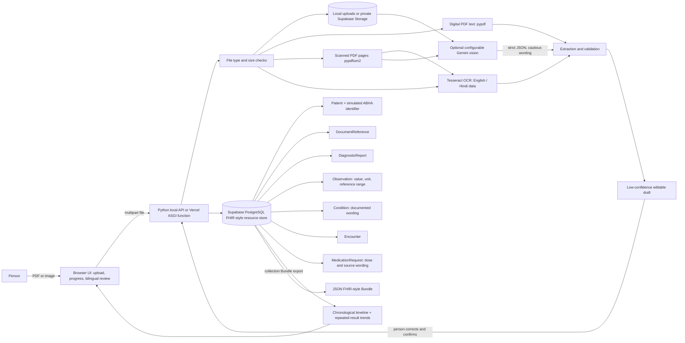

# AI-Powered Personal Health Copilot

MedLens is a hackathon-ready prototype that turns uploaded health documents into an editable, chronological, FHIR-style personal record. Structured health records are stored in Supabase PostgreSQL; locally, uploaded files remain on the app server, while Vercel deployments store them in a private Supabase Storage bucket. It is designed for record organization and patient education; it does not diagnose, prescribe, recommend treatment changes, or connect to the ABDM network.

## Why this stack

Python's standard-library HTTP server keeps the API lightweight, while Supabase PostgreSQL provides persistent hosted storage for the FHIR-style resources. A dependency-free browser UI keeps the prototype easy to run; optional PDF/OCR tooling and an environment-configured Gemini vision endpoint improve extraction.

## Run locally

Requires Python 3.10 or newer and a Supabase project. First copy `.env.example` to `.env` and set `SUPABASE_DB_URL` using the PostgreSQL connection string from **Supabase → Project Settings → Database → Connection string**. This must begin with `postgres://` or `postgresql://`; the `https://<project-ref>.supabase.co` project URL and publishable key are not database credentials for this Python backend. Keep the URI private; use the session pooler URI if your network cannot access the direct database. If the database password contains reserved URI characters (such as `@`, `/`, or `:`), URL-encode the password in the connection string. Then, from this folder:

```powershell
Copy-Item .env.example .env
# Edit .env and set SUPABASE_DB_URL
python -m pip install -r requirements.txt
python server.py
```

Then open <http://127.0.0.1:8000>. On Windows, `run.bat` runs the same server. On first startup, the app creates the FHIR resource tables in the Supabase database and seeds the fictional demo patient and sample documents. Keep `SUPABASE_DB_URL` in the server-side `.env` only; never put it in frontend code or commit it. Existing records in the former local SQLite database are not copied automatically.

The interface and editable record summaries are available in English, Hindi, Marathi, Tamil, and Telugu. Choose a language from the selector in the sign-in screen or workspace header. AI extraction is prompted to return a cautious summary in all five languages; local extraction also creates all five summaries without changing medical names, values, units, or printed ranges.

The app binds to loopback (`127.0.0.1`) by default. Its opening sign-in screen is a **presentation-only demo gate**; it does not authenticate users, and the API and uploaded files are not protected. If hosting for a demo, use the hosting platform's access restriction (or keep the deployment private), terminate connections with HTTPS, and use fictional sample data only. Never expose the app publicly with real patient records. Locally, uploads are stored under `data/uploads/` on the app server, which is excluded from version control. On Vercel, uploads go to a private Supabase Storage bucket because the function filesystem is temporary. Deleting a record in the UI deletes its uploaded file and its linked structured resources.

### Supabase database

The app connects directly to Supabase PostgreSQL from the Python backend using `psycopg`. On first launch it runs the idempotent DDL in `schema.sql`, then seeds the demo data only when no Patient resource exists. Row Level Security is enabled without public policies; server-side access uses the database connection only. `SUPABASE_DB_URL` is a privileged database credential: keep it server-side, restrict access to the Supabase project, and rotate it if exposed. Supabase stores structured records; local uploads stay on the app server, and Vercel uploads use private Supabase Storage. The demo has no user authentication or per-user isolation, backups, audit trails, encryption-at-rest, or healthcare compliance; use fictional data only.

### Deploy to Vercel Hobby

This deployment target is for a private, fictional-data demo only. Vercel serves the Python ASGI entrypoint in `api/index.py`; `vercel.json` routes API, upload, and static-file requests through it. Vercel's function filesystem is temporary, so source documents are stored in a **private** Supabase Storage bucket. The app caps uploads at 4 MB on Vercel to stay below the platform's request-body limit; local uploads retain the configured `MAX_UPLOAD_MB` limit.

1. Push this project to a Git provider and import it as a Vercel project. Keep the project access restricted; the app itself has no authentication.
2. In Supabase, create a **private** Storage bucket named `medlens-uploads` (or choose another name and set the matching environment variable). Do not add public read policies.
3. In Vercel **Project Settings → Environment Variables**, set:

   | Variable | Value |
   | --- | --- |
   | `SUPABASE_DB_URL` | Supabase PostgreSQL connection URI |
   | `SUPABASE_URL` | Supabase project URL, such as `https://<project-ref>.supabase.co` |
   | `SUPABASE_SERVICE_ROLE_KEY` | Server-side `service_role` secret from Supabase; never expose it to browser code |
   | `SUPABASE_STORAGE_BUCKET` | `medlens-uploads`, or the private bucket name you created |
   | `AI_API_KEY` | Optional Gemini API key; omit or leave empty to use local extraction |
   | `AI_BASE_URL` | Optional; defaults to Gemini's OpenAI-compatible endpoint |
   | `AI_MODEL` | Optional; defaults to the model configured in `.env.example` |

   Set secrets for the Production environment and any Preview environment you intend to use; never commit these values. Do not use the Supabase anon/publishable key in place of `SUPABASE_SERVICE_ROLE_KEY`.
4. Deploy. The app initializes its database schema and fictional sample data on the first function request. Confirm `/api/health` reports success before demonstrating the upload flow.

**Vercel OCR limitation:** Tesseract is an external native executable and is not bundled in this Python Function. Digital PDF text extraction still works; Gemini vision can process supported images and rendered PDF pages when `AI_API_KEY` is configured. Without Gemini, scanned documents may produce only a low-confidence/manual-review draft. Always verify results against the uploaded source. If dependable OCR for scanned or handwritten documents is a requirement, use a separately hosted OCR service or a container-capable host with Tesseract installed.

### Optional AI extraction

Copy `.env.example` to `.env`, then set your Gemini API key from Google AI Studio. The default endpoint and model are already configured for Gemini:

```dotenv
AI_BASE_URL=https://generativelanguage.googleapis.com/v1beta/openai/
AI_API_KEY=your-gemini-api-key
AI_MODEL=gemini-3.5-flash
```

The key is read from the server environment and is not included in the browser or source. Add it only to the local `.env` file; do not paste API keys into chat or commit them. When configured, Gemini receives the uploaded text and, for images or rendered PDF pages, image data to extract the record. Use fictional demo documents only unless Google's terms, your organization, and applicable privacy requirements authorize processing sensitive health information. The upload screen discloses AI processing before a file is selected. Confidence is adjusted using source image resolution, contrast, sharpness, OCR text readability, and extracted fields. It is a heuristic rather than a calibrated probability of correctness; uncertain results remain unconfirmed until reviewed.

Optional environment settings:

| Variable | Default | Purpose |
| --- | --- | --- |
| `AI_BASE_URL` | Gemini OpenAI-compatible endpoint | AI API base URL |
| `AI_API_KEY` | empty | Gemini API key; empty means no cloud AI |
| `AI_MODEL` | `gemini-3.5-flash` | Gemini multimodal model |
| `SUPABASE_DB_URL` | required | Supabase PostgreSQL connection URI; server-only secret |
| `SUPABASE_URL` | empty | Supabase project URL; required for hosted uploads |
| `SUPABASE_SERVICE_ROLE_KEY` | empty | Server-only Storage credential; required for Vercel uploads |
| `SUPABASE_STORAGE_BUCKET` | `medlens-uploads` | Private bucket name for Vercel uploads |
| `TESSERACT_CMD` | auto-detected | OCR executable; checks `PATH` and the standard Windows install directory |
| `TESSERACT_LANGS` | auto-detected | Optional plus-separated installed OCR languages, e.g. `eng+hin+mal` |
| `MAX_UPLOAD_MB` | `12` | Maximum local accepted file size; Vercel is capped at 4 MB |
| `HOST` | `127.0.0.1` | Bind interface; do not expose the demo publicly |
| `PORT` | `8000` | HTTP port |

Install Tesseract to OCR image files and rendered scanned PDF pages. On Windows, MedLens automatically checks `C:\Program Files\Tesseract-OCR\tesseract.exe` if Tesseract is not on `PATH`; set `TESSERACT_CMD` only when using a non-standard location. Pillow preprocessing automatically corrects EXIF orientation, enlarges small images, improves contrast, and sharpens text before trying both normal and sparse-page layouts. English OCR works with `eng`. Install Tesseract's language data for scripts present in your documents (`hin`, `mar`, `tam`, `tel`, `mal`) and set `TESSERACT_LANGS=eng+hin` or another plus-separated list in `.env`; MedLens only selects installed models and warns if a requested model is unavailable. OCR is not reliable for every handwritten note, and medication names/doses should always be compared with the original. The `pypdf` and `pypdfium2` requirements extract digital PDF text and render scanned PDF pages. When OCR or PDF rendering is unavailable, the app reports a processing warning and keeps the draft unconfirmed for manual review instead of claiming accurate extraction. Vision extraction processes up to five PDF pages per AI request and reports page-limit warnings.

## Demo flow

1. Continue through the no-password demo screen as the fictional Aarav Sharma patient. On the overview, point out the fictional sample records, explicit sample/out-of-range wording, and ABHA simulation label.
2. Open **Health profile**. Show the Patient, DocumentReference, DiagnosticReport, Observation, Condition, Encounter, and MedicationRequest resource counts, repeat total-cholesterol trend, and **Export FHIR bundle**.
3. Click **Link demo ABHA** and save a fictional 14-digit ID. Explain that it updates the simulated identifier only; it never calls ABDM.
4. Upload a sample prescription, lab report, discharge note, PDF, or photo. Show upload progress, OCR/model warnings, confidence, and the editable review form for date, document type, medicines, doses, test values/units/reference ranges, and documented diagnoses.
5. Correct at least one field from the source, then confirm. Point out the new timeline entries and its status changing to reviewed.
6. Switch to हिन्दी; revisit a summary to show the Hindi version and the same safety caveat.
7. Filter the timeline and finish by exporting the JSON FHIR collection bundle.

### Suggested presenter wording

“This is a private-by-default record organizer, not an automated clinician. The model's job is to transcribe and explain only what the document says, preserving units and printed reference ranges. Every draft shows confidence and must be checked by a person before it becomes part of the profile. Abnormal-range text is descriptive, not a diagnosis or care instruction. The ABHA control is a simulation, and all demo records are fictional.”

## Architecture



## Data model and API

`schema.sql` defines the Supabase PostgreSQL resource store rather than tying the prototype to document-specific relational columns: each row carries a FHIR `resource_type`, patient reference, and complete JSON resource. Indexed resource types and Patient IDs make common profile reads straightforward; resource IDs are stable within a stored record. The resource payloads use familiar FHIR R4-style shapes and references:

| Resource | Prototype use |
| --- | --- |
| `Patient` | Fictional seeded demographics and a simulated ABHA value stored under a MedLens-owned identifier system, not as a verified ABDM identifier |
| `DocumentReference` | Uploaded source metadata, OCR text, confidence, review status, localized explanations, and links to reviewed records |
| `DiagnosticReport` | Lab report metadata and result references |
| `Observation` | Exact test value, UCUM-style unit, printed reference range, date, and a range comparison when numeric bounds were actually extracted |
| `MedicationRequest` | Medicine name, transcribed dose/instructions, source date, and status |
| `Condition` | Wording documented in the source, marked unconfirmed rather than asserted as a new diagnosis |
| `Encounter` | Seeded outpatient visits and dates |
| `Bundle` | Export of all stored resources as a collection bundle |

Local endpoints: `GET /api/health`, `GET /api/profile`, `POST /api/upload` (multipart), `POST /api/documents/{id}/confirm`, `DELETE /api/documents/{id}`, `POST /api/abha/simulate`, and `GET /api/export/fhir`.

## Safety, scope, and known limitations

- Every uploaded draft is visibly unconfirmed, includes an extraction confidence, and opens in an editable review form; low-confidence extraction calls out that source text may be missing.
- Model instructions explicitly prohibit diagnosis and treatment advice. English and Hindi summaries repeat that range comparisons are not diagnoses and must not prompt treatment changes; users are directed to ask their clinician.
- Numeric “high/low” flags are computed only when a value and machine-readable printed bounds exist. Text-only reference ranges are preserved verbatim and are not guessed into thresholds.
- Local parsing is deliberately cautious, not a substitute for a clinical NLP model. Handwriting, faint scans, mixed-language records, uncommon units, and complex tables can be misread; inspect the source before confirming.
- OCR, model, and PDF parsing failures are reported with warnings. A user can still correct a blank/partial draft manually.
- The ABHA ID and import experience is **simulation-only**. The displayed demo value uses a MedLens-owned FHIR identifier system so it is not presented in exports as a verified ABDM identifier. No ABDM authentication, consent manager, gateway, live ABHA validation, or record fetch is implemented.
- This prototype has no user accounts, production-grade access controls, audit trail, encryption-at-rest, backups, or healthcare compliance certification. Do not expose it to the internet or enter real patient data.

## Test

```powershell
python -m unittest -v test_server.py
```

Tests cover extraction fields, safe wording, confidence handling, validation, and FHIR observation output.

## Hackathon slide outline

1. **The problem:** people receive scattered medical documents, unfamiliar terminology, and no unified personal timeline.
2. **The solution:** MedLens ingests records, explains the document in plain language, and organizes the information into an editable profile.
3. **Trust and safety:** cautious extraction prompts, low-confidence review, source-first correction, reference-range context, visible disclaimers, and no treatment decisions.
4. **Technical approach:** upload → OCR/vision → validated structured extraction → human confirmation → Supabase PostgreSQL/FHIR-style resources → timeline, trends, export.
5. **Demo and impact:** walk through the sample records, multilingual summary, repeat lab trend, a reviewed upload, and collection Bundle export.
6. **ABDM readiness and privacy:** simulated ABHA only today; FHIR-style patient-centric records are the integration seam; Supabase database and local upload storage are disclosed clearly.
7. **Next steps:** validate extraction against consented, de-identified documents; improve multilingual handwriting support; add authentication, auditability, consent, security review, and certified ABDM integration before any real deployment.
